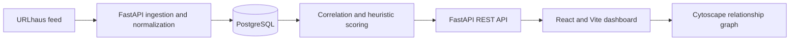

# Threat Intelligence Correlation Tool

A full-stack data application for collecting, normalizing, and exploring indicator records from a public feed. The project brings together a React interface, a FastAPI service, and PostgreSQL, with an interactive relationship graph and operational dashboard.

## Overview

The application ingests URLhaus records on demand, normalizes and deduplicates indicator values, stores their relationships to campaigns and sources, and exposes the resulting data through a REST API. The frontend presents summary metrics, indicator details, and an interactive Cytoscape graph.

The project focuses on practical software engineering concerns: a clear API boundary, relational data modeling, repeatable local setup, automated tests, containerized infrastructure, and a responsive data-heavy interface.

## Technology Stack

- **Frontend:** React, Vite, Cytoscape.js
- **Backend:** Python, FastAPI, SQLAlchemy
- **Database:** PostgreSQL 16
- **Infrastructure:** Docker Compose
- **Testing:** Pytest, FastAPI TestClient, in-memory SQLite test fixtures

## Architecture



PostgreSQL runs in Docker Compose. The backend and frontend run as local development processes and communicate over HTTP. The backend creates its tables at startup; ingestion is an explicit API action and is not run automatically.

## Engineering Features

- REST endpoints for indicators, campaigns, sources, statistics, graph data, and ingestion.
- Indicator normalization and duplicate detection before persistence.
- Relational SQLAlchemy models connect indicators, campaigns, sources, and risk scores; FastAPI routers and service modules separate HTTP handling from correlation and scoring logic.
- Batch risk-score calculation with dry-run support.
- Interactive relationship graph and dashboard backed by the same API.
- Automated API and service tests using isolated in-memory SQLite fixtures.
- Dockerized PostgreSQL with a persistent named volume for local development.

### Development-Dataset Results

- An optimization reduced the graph endpoint response time from approximately **17.4 seconds to 0.05 seconds** on the development dataset.
- The application successfully processed **28,148 indicators** during local testing. This is a local functional/data-volume result, not a production benchmark.

Measurements depend on the local machine and dataset and have not been presented as production performance claims.

## Local Setup

Prerequisites: Docker Desktop with Compose, Python 3.13, and Node.js with npm.

1. Create local configuration files from the checked-in examples. `-n` leaves any existing local configuration untouched:

   ```bash
   cp -n .env.example .env
   cp -n backend/.env.example backend/.env
   ```

2. Compose reads the root `.env`: set `POSTGRES_USER`, `POSTGRES_PASSWORD`, `POSTGRES_DB`, and optionally `POSTGRES_PORT` there. Set `backend/.env`'s `DATABASE_URL` to use the same username, password, database, and host port. If the password contains URL-reserved characters, percent-encode it in the URL.

3. Validate the Compose configuration and start PostgreSQL:

   ```bash
   docker compose config -q
   docker compose up -d postgres
   ```

   PostgreSQL is available at `127.0.0.1:5433` by default. Compose stores data in the named `postgres_data` volume, which survives container recreation. For an existing volume, the Compose initialization variables do not change the database's existing credentials; keep `.env` and `DATABASE_URL` aligned with that database. Do not remove the volume to change credentials or if you need to retain its data.

4. Install backend dependencies and start the API in a terminal:

   ```bash
   python3 -m venv backend/venv
   source backend/venv/bin/activate
   pip install -r backend/requirements.txt
   cd backend
   uvicorn app.main:app --reload --host 127.0.0.1 --port 8000
   ```

5. Install frontend dependencies and start Vite in another terminal:

   ```bash
   cd frontend
   npm ci
   npm run dev
   ```

Open the dashboard at `http://localhost:5173`. The frontend uses `http://localhost:8000` by default; set `VITE_API_URL` in `frontend/.env` to use a different API origin.

To stop the local database without deleting its data, run `docker compose stop postgres`. Avoid `docker compose down -v` if the database volume must be preserved.

## Environment Configuration

| File            | Purpose                                                                                                     |
| --------------- | ----------------------------------------------------------------------------------------------------------- |
| `.env`          | Compose settings for the PostgreSQL user, password, database, and host port. Create it from `.env.example`. |
| `backend/.env`  | Backend `DATABASE_URL`. Create it from `backend/.env.example`.                                              |
| `frontend/.env` | Optional `VITE_API_URL` override. The checked-in `frontend/.env.example` shows the default.                 |

These local files are ignored by Git. Example files contain development placeholders only; set your own local password and keep real credentials out of the repository.

## API Documentation

With the backend running, interactive OpenAPI documentation is available at [`http://localhost:8000/docs`](http://localhost:8000/docs), with the alternative ReDoc interface at [`http://localhost:8000/redoc`](http://localhost:8000/redoc).

| Method        | Endpoint                                             | Purpose                                      |
| ------------- | ---------------------------------------------------- | -------------------------------------------- |
| `GET`         | `/`                                                  | API status                                   |
| `GET`         | `/db-health`                                         | Check database connectivity                  |
| `GET`, `POST` | `/indicators`                                        | List or create indicators                    |
| `GET`         | `/indicators/{id}`                                   | Retrieve indicator details and relationships |
| `GET`         | `/indicators/{id}/risk`                              | Retrieve the latest risk score               |
| `GET`         | `/indicators/{id}/correlations`                      | Retrieve indicator correlations              |
| `GET`         | `/risk-scores`                                       | List calculated risk scores                  |
| `GET`, `POST` | `/campaigns`                                         | List or create campaigns                     |
| `GET`         | `/campaigns/{id}`                                    | Retrieve a campaign                          |
| `POST`        | `/campaigns/{campaign_id}/indicators/{indicator_id}` | Link an indicator to a campaign              |
| `GET`, `POST` | `/sources`                                           | List or create sources                       |
| `GET`         | `/stats`                                             | Retrieve dashboard summary metrics           |
| `GET`         | `/graph`                                             | Retrieve graph nodes and relationships       |
| `POST`        | `/ingest/urlhaus`                                    | Fetch and process URLhaus feed records       |

The ingestion endpoint contacts the external URLhaus service and writes records to the configured database. It is documented here for intentional use; setup, tests, and startup do not invoke it.

## Risk-Score Interpretation

Risk scores are deterministic heuristic estimates based on available relationship, observation, and recency data. They are not verified threat severity, a calibrated probability, or a substitute for analyst review. Treat score bands as a prioritization aid only.

## Testing and Quality Checks

Run the backend tests from the repository root:

```bash
cd backend
source venv/bin/activate
pytest -q
```

Run the frontend production build and lint checks:

```bash
cd frontend
npm ci
npm run build
npm run lint
```

The backend tests use in-memory SQLite and do not require PostgreSQL or feed ingestion.

## Screenshots

No screenshots are included yet. Add genuine captures of the running dashboard and graph here when available; do not use mockups as application screenshots.

## Repository Hygiene

Local environment files, virtual environments, dependency folders, databases, SQL dumps, caches, and build outputs are excluded by `.gitignore`. Before publishing, verify that no credentials, database exports, or locally imported data have been staged or committed.
